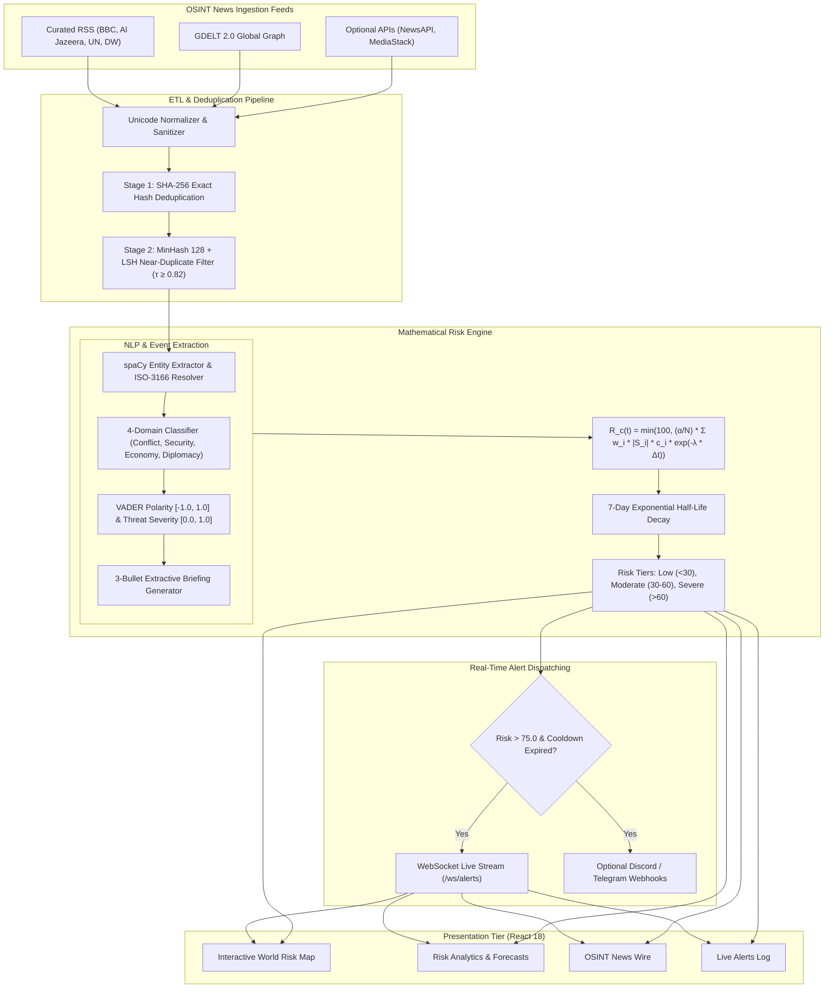

# GeoSentinel AI
### Global Geopolitical Threat Intelligence & Explainable Country Risk Scoring Platform

[](https://www.python.org/)
[](https://fastapi.tiangolo.com/)
[](https://react.dev/)
[](https://tailwindcss.com/)
[](https://www.docker.com/)
[](LICENSE)

---

## 1. Project Overview

**GeoSentinel AI** is a geopolitical threat intelligence platform that ingests, deduplicates, and analyzes open-source global news feeds to produce continuous, mathematically transparent country risk scores and real-time threshold alerts.

Designed to eliminate black-box risk algorithms, GeoSentinel AI computes every country risk index through a closed-form formula with continuous exponential temporal decay ($\lambda = \ln(2)/7$, exact 7-day half-life). Every score is directly traceable to raw OSINT articles, classified event severity vectors, and source credibility metrics.

### Core Capabilities
- **Autonomous Multi-Source OSINT Ingestion**: Live ingestion across open-access RSS feeds (BBC World, Al Jazeera, UN News, Deutsche Welle, France 24, The Guardian, Sky News), GDELT 2.0 Global Knowledge Graph, and optional NewsAPI / MediaStack feeds.
- **Two-Stage Deduplication Engine**: Exact cryptographic deduplication (SHA-256) followed by near-duplicate detection via 128-permutation MinHash and Locality-Sensitive Hashing (LSH, $\tau \ge 0.82$) in a rolling 48-hour comparison window.
- **4-Domain NLP Classification & NER**: Real-time event classification into `CONFLICT`, `SECURITY`, `ECONOMY`, and `DIPLOMACY` (TF-IDF classifier with lexicon fallback), VADER sentiment polarity, and ISO-3166-1 alpha-3 country resolution via spaCy NER.
- **Explainable Risk Scoring & Forecasting**: Closed-form 7-day half-life decay risk scoring with per-domain breakdown, historical time series, and Holt's damped linear exponential smoothing forecasts.
- **Real-Time Alert Dispatching**: WebSocket live alert stream (`/ws/alerts`) with 6-hour cooldown suppression and optional Discord / Telegram webhook notifications upon critical threshold breach ($R_c(t) > 75.0$).
- **Data Export**: Direct JSON/print country reports inside the country inspector, plus RFC-7946 GeoJSON (`/api/risk/export/geojson`) and CSV (`/api/events/export/csv`) exports.

---

## 2. Main Views

| View / Module | Technology | Description |
| :--- | :--- | :--- |
| **World Risk Map** | Leaflet + React-Leaflet + Esri/OSM | Interactive world risk map with Dark, Satellite, and OSM basemaps, tier filters, and click-to-inspect country evidence modals with direct JSON/Print export. |
| **Risk Analytics** | Recharts + Holt's Linear Smoothing | Longitudinal event velocity charts, 4-domain category distribution, and filterable sovereign risk ranking matrix. |
| **OSINT News Wire** | SHA-256 + MinHash LSH | Searchable, filterable deduplicated news wire showing source credibility, deduplication status badges, and direct source citations. |
| **Live Alerts** | WebSocket + Optional Webhooks | Real-time critical threshold ($R > 75.0$) alert log, WebSocket toast banners, and live Discord/Telegram webhook configuration status. |

---

## 3. Technology Stack

### Backend
- **Framework**: FastAPI (Python 3.11+) with async ASGI event loop
- **Production Server**: Gunicorn with Uvicorn workers
- **Persistence**: PostgreSQL 15+ / SQLite via SQLAlchemy 2.0 Async Engine + Alembic Migrations
- **Scheduling**: Built-in `asyncio` background poller for periodic OSINT ingestion and LSH window cleanup
- **NLP & ML**: spaCy (`en_core_web_sm`), NLTK VADER, scikit-learn (TF-IDF classifier), datasketch (MinHash LSH)
- **HTTP Client**: HTTPX async client

### Frontend
- **Framework**: React 18 + Vite 5
- **Styling**: Tailwind CSS 3.4
- **Maps**: Leaflet 1.9 & React-Leaflet 4.2
- **Charts**: Recharts 2.12
- **Icons**: Lucide React
- **Real-Time**: REST API + native WebSocket with reconnect

---

## 4. Architecture



### Mathematical Risk Formulation
Every country's risk score $R_c(t)$ is computed using the closed-form equation:

$$R_c(t) = \min\left(100,\; \frac{\alpha}{N_c(T)} \sum_{i=1}^{N_c(T)} w_i \cdot |S_{a,i}| \cdot c_{s,i} \cdot e^{-\lambda(t - t_i)}\right)$$

- **$\alpha = 4.25$**: Calibrated normalization scalar.
- **$\lambda = \frac{\ln 2}{7} \approx 0.099021\text{ day}^{-1}$**: Exact 7-day half-life decay.
- **$w_i$**: Category weights: `CONFLICT` ($1.00$), `SECURITY` ($0.80$), `ECONOMY` ($0.55$), `DIPLOMACY` ($0.35$).
- **$|S_{a,i}| \in [0.0, 1.0]$**: Absolute sentiment polarity magnitude.
- **$c_{s,i} \in [0.1, 1.0]$**: Source credibility rating.
- **$T = 30\text{ days}$**: Active observation sliding window.

---

## 5. Installation & Quick Start

### Prerequisites
- **Python**: 3.11+
- **Node.js**: v18+ (v20+ recommended)

### Backend Setup
```bash
python -m venv .venv
# Windows PowerShell:
.\.venv\Scripts\Activate.ps1
# Linux / macOS:
source .venv/bin/activate

pip install --upgrade pip
pip install -r backend/requirements.txt
python -m spacy download en_core_web_sm
```

### Frontend Setup
```bash
cd frontend
npm install
cd ..
```

### Environment Configuration
```bash
cp .env.example .env
```

### Running Locally
- **One-Click Windows Launcher**: Double-click `start_demo.bat` or run `.\run_demo.ps1`
- **Manual Backend**: `python -m uvicorn app.main:app --app-dir backend --host 127.0.0.1 --port 8000 --reload`
- **Manual Frontend**: `cd frontend && npm run dev`

---

## 6. Docker Deployment

```bash
# Development
docker compose up -d --build

# Production (PostgreSQL + Gunicorn/Uvicorn + Nginx)
docker compose -f docker-compose.prod.yml up -d --build
```

---

## 7. Testing & Verification

```bash
# Run backend test suite
python -m pytest -v

# Verify live endpoints
python scripts/verify_endpoints.py

# Build frontend
cd frontend && npm run build
```

---

## 8. License
MIT License — see [LICENSE](LICENSE).
