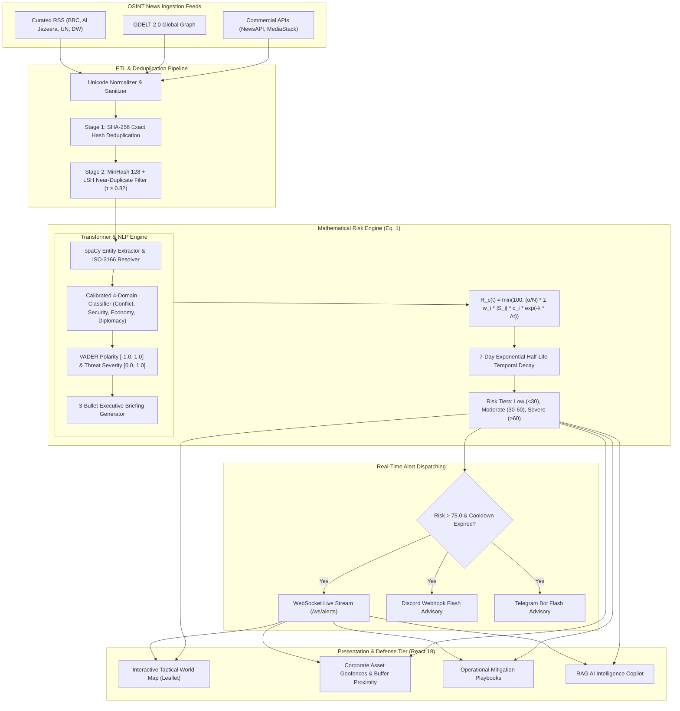

# GeoSentinel AI
### Production-Grade Global Geopolitical Threat Intelligence, Asset Defense & Risk Forecasting Platform

[](https://www.python.org/)
[](https://fastapi.tiangolo.com/)
[](https://react.dev/)
[](https://tailwindcss.com/)
[](https://www.docker.com/)
[](backend/tests/)
[](LICENSE)

---

## 1. Project Overview

**GeoSentinel AI** is an enterprise-grade Geopolitical Threat Intelligence and Operations Center (GTOC) platform that ingests, deduplicates, and analyzes open-source global news feeds to produce continuous, mathematically transparent country risk scores and automated supply-chain defense directives.

Designed to eliminate the "black-box opacity" of black-box risk algorithms, GeoSentinel AI computes every risk index through a closed-form formula with continuous exponential temporal decay ($\lambda = \ln(2)/7$, exact 7-day half-life). Every risk score is directly traceable to raw OSINT articles, classified event severity vectors, and source credibility metrics.

### Key Capabilities:
- **Autonomous Multi-Source OSINT Ingestion**: Live ingestion across open-access feeds (BBC World, Al Jazeera, UN News, Deutsche Welle, France 24, The Guardian, Sky News), GDELT 2.0 Global Knowledge Graph, NewsAPI, and MediaStack.
- **Two-Stage Deduplication Engine**: Exact cryptographic deduplication (SHA-256) followed by near-duplicate detection via 128-permutation MinHash and Locality-Sensitive Hashing (LSH, $\tau \ge 0.82$) in a rolling 48-hour comparison window.
- **4-Domain NLP Classification & NER**: Real-time event extraction into `CONFLICT`, `SECURITY`, `ECONOMY`, and `DIPLOMACY`, resolving ISO-3166-1 alpha-3 territory coordinates and entity recognition via spaCy.
- **Corporate Asset Geofencing & Maritime Defense**: Spherical Haversine distance proximity monitoring protecting critical facilities (fabs, data centers, ports, refineries) and strategic maritime transit chokepoints (Bab-el-Mandeb, Strait of Hormuz, Malacca, Suez, Turkish Straits).
- **Executive Mitigation Playbooks**: Standard Operating Procedures (SOPs) with BIMCO legal maritime clauses, quantified financial variance analysis, and phased action plans.
- **What-If Tactical Simulation Sandbox**: Interactive scenario simulator modeling sovereign risk spikes and regional spillover effects.
- **RAG-Powered AI Intelligence Copilot**: On-demand analytical briefings synthesizing real-time database intel and verifiable evidence links.
- **Automated External Webhooks**: Live push flash advisories dispatched to Discord webhooks and Telegram bot channels upon critical threshold breach ($R_c(t) > 75.0$).

---

## 2. Main Features

| Feature Module | Technology / Methodology | Description |
| :--- | :--- | :--- |
| **Tactical World Risk Map** | Leaflet + React-Leaflet + Esri Canvas | Interactive choropleth map featuring Dark Gray Canvas, Satellite imagery, OpenStreetMap vectors, corporate asset geofence buffers, and maritime chokepoint transit corridors. |
| **Risk Analytics & Forecast** | Recharts + EWMA / Holt-Winters | 14-day to 90-day longitudinal risk trajectory charts, category distributions, event velocity, and sovereign ranking matrix. |
| **OSINT News Wire Feed** | Two-Stage Deduplication (SHA-256 + LSH) | Searchable and filterable deduplicated news wire showing credibility scores, deduplication signal badges, source attribution, and direct URLs. |
| **Real-Time Alert Dispatcher** | WebSocket + Discord + Telegram | Immediate visual flash banners, audio cues, and webhook dispatches when country risk breaches $R > 75.0$ with active 6-hour cooldown suppression. |
| **Corporate Asset Defense** | Haversine Distance Spherical Geofencing | Automated perimeter threat assessment for factories, vessels, and depots with prescriptive action directives. |
| **Actionable Playbooks** | BIMCO Maritime & Supply Chain Protocols | Turnkey contingency execution plans with schedule impact and financial variance metrics. |
| **What-If Scenario Sandbox** | Multi-Vector Risk Simulator | Interactive injection of hypothetical incident clusters to evaluate projected risk shifts and regional spillovers. |
| **Strategic Intelligence Dossier** | Dynamic Report Generator | Formatted country threat dossiers exportable to JSON, Markdown, and print/PDF ready formats. |

---

## 3. Technology Stack

### Backend
- **Framework**: FastAPI (Python 3.11+) with ASGI asynchronous event loop
- **Production Server**: Gunicorn process supervisor with Uvicorn async workers (`uvicorn.workers.UvicornWorker`)
- **Persistence**: PostgreSQL 15+ / SQLite via SQLAlchemy 2.0 Async Engine + Alembic Migrations
- **Background Tasks**: Celery 5.3+ / Redis 7.0 (with standalone in-app fallback scheduler)
- **NLP & ML**: spaCy (`en_core_web_sm`), NLTK VADER sentiment analyzer, scikit-learn, datasketch (MinHash LSH)
- **HTTP Client**: HTTPX async HTTP client with automated connection timeouts
- **Telemetry**: Prometheus `/api/metrics` exposition + structured JSON logging

### Frontend
- **Framework**: React 18 (Vite 5 SPA bundler)
- **Styling**: Tailwind CSS 3.4 with custom GTOC dark theme
- **Geospatial Maps**: Leaflet 1.9 & React-Leaflet 4.2 with Esri Dark/Satellite tile layers
- **Visual Analytics**: Recharts 2.12
- **Icons**: Lucide React
- **Protocol**: REST APIs + native HTML5 WebSocket connection with exponential reconnect

---

## 4. Architecture



### Mathematical Risk Formulation:
Every country's risk score $R_c(t)$ is computed using the closed-form equation:

$$R_c(t) = \min\left(100,\; \frac{\alpha}{N_c(T)} \sum_{i=1}^{N_c(T)} w_i \cdot |S_{a,i}| \cdot c_{s,i} \cdot e^{-\lambda(t - t_i)}\right)$$

- **$\alpha = 4.25$**: Calibrated normalization scalar.
- **$\lambda = \frac{\ln 2}{7} \approx 0.099021\text{ day}^{-1}$**: Exact 7-day half-life decay ensuring continuous recency weighting.
- **$w_i$**: Category weights: `CONFLICT` ($1.00$), `SECURITY` ($0.80$), `ECONOMY` ($0.55$), `DIPLOMACY` ($0.35$).
- **$|S_{a,i}| \in [0.0, 1.0]$**: Absolute sentiment polarity magnitude.
- **$c_{s,i} \in [0.1, 1.0]$**: Verified source credibility rating.
- **$T = 30\text{ days}$**: Active observation temporal sliding window.

---

## 5. Installation

### Prerequisites
- **Python**: 3.11 or higher
- **Node.js**: v18 or higher (v20+ recommended)
- **Git**

### Clone Repository:
```bash
git clone https://github.com/praneetpravin/geosentinel-ai.git
cd geosentinel-ai
```

### Backend Virtual Environment Setup:
```bash
# Create and activate virtual environment
python -m venv .venv

# Windows PowerShell:
.\.venv\Scripts\Activate.ps1

# Linux / macOS:
source .venv/bin/activate

# Install dependencies
pip install --upgrade pip
pip install -r backend/requirements.txt

# Download lightweight spaCy core model for NER
python -m spacy download en_core_web_sm
```

### Frontend Dependencies:
```bash
cd frontend
npm install
cd ..
```

---

## 6. Environment Configuration

Copy the example environment template to create your active `.env`:
```bash
cp .env.example .env
```

Key environment configuration variables:
```ini
# Application Mode
ENVIRONMENT=development
DEBUG=true
SECRET_KEY=change-this-to-a-secure-random-64-character-hex-key

# Database (SQLite for dev, PostgreSQL for Docker / production)
DATABASE_URL=sqlite+aiosqlite:///./geosentinel.db

# Ingestion Source Keys (Optional: Curated RSS and GDELT work out of the box with zero keys!)
NEWSAPI_KEY=
MEDIASTACK_KEY=
GDELT_ENABLED=true
RSS_ENABLED=true
POLLING_INTERVAL_MINUTES=15

# Real-Time Flash Alert Webhooks (Optional)
DISCORD_WEBHOOK_URL=
TELEGRAM_BOT_TOKEN=
TELEGRAM_CHAT_ID=
WEBHOOKS_ENABLED=false

# Allowed CORS Origins
CORS_ORIGINS=["http://localhost:5173", "http://localhost:3000", "http://127.0.0.1:5173", "http://127.0.0.1:3000"]
```

---

## 7. Database Setup & Alembic Migrations

GeoSentinel supports both zero-setup SQLite for rapid local evaluation and high-availability PostgreSQL for enterprise deployments.

### Initializing Database Schema via Alembic:
```bash
# Apply versioned database migrations
python -m alembic upgrade head
```

### Pre-Seeding Demo Baseline Data (Optional):
If starting with an empty database and `DEMO_MODE=True`, GeoSentinel automatically seeds baseline verified OSINT articles, corporate asset geofences, and operational playbooks upon startup.
You can also manually trigger seeding:
```bash
python scripts/seed_demo_data.py
```

---

## 8. Running Frontend and Backend

### Option A: One-Click Operations Launcher (Windows)
Double-click `start_demo.bat` or run:
```powershell
powershell -NoProfile -ExecutionPolicy Bypass -File .\run_demo.ps1
```
This automatically boots Uvicorn, launches Vite dev server, performs a health probe, and opens `http://localhost:5173` in your default browser.

### Option B: Manual Execution

#### Terminal 1 — Backend:
```bash
# From workspace root with .venv active:
python -m uvicorn app.main:app --app-dir backend --host 127.0.0.1 --port 8000 --reload
```
- Interactive API Docs: `http://127.0.0.1:8000/docs`
- Health Probe: `http://127.0.0.1:8000/api/health`
- Prometheus Telemetry: `http://127.0.0.1:8000/api/metrics`

#### Terminal 2 — Frontend:
```bash
cd frontend
npm run dev
```
- Tactical Command Console: `http://localhost:5173`

---

## 9. AI/ML Model Requirements

GeoSentinel AI uses efficient, deterministic NLP pipelines with trained artifacts and local inference:

| Component | Architecture | Artifact / Dependency | Fallback Mode |
| :--- | :--- | :--- | :--- |
| **Category Classifier** | TF-IDF + Multinomial Classifier | `backend/app/nlp/classifier_model.joblib` | Calibrated domain semantic lexicon |
| **Named Entity Recognition** | spaCy small English web model | `en_core_web_sm` | Regularized country & alias dictionary |
| **Sentiment Polarity** | VADER Sentiment Analyzer | `nltk.sentiment.vader_lexicon` | Domain keyword polarity differential |
| **Executive Briefing** | Structured 3-Bullet Synthesizer | Built-in Extractive Briefing Model | Domain implication template engine |
| **Two-Stage Deduplication** | SHA-256 + MinHash 128 LSH | `datasketch` LSH Index ($\tau \ge 0.82$) | Native shingle Jaccard comparator |

To retrain or benchmark the classifier:
```bash
python ml/classification/train_classifier.py
```

---

## 10. Production Deployment

### Option A: Production Docker Compose Stack
The production compose configuration runs security-hardened, non-root containers with Nginx reverse proxy, PostgreSQL 15, Redis 7, Celery Worker, and Gunicorn/Uvicorn cluster:

```bash
# 1. Populate production variables
cp .env.example .env

# 2. Build and launch production stack in detached mode
docker compose -f docker-compose.prod.yml up -d --build

# 3. Check container health status
docker compose -f docker-compose.prod.yml ps

# 4. View real-time cluster logs
docker compose -f docker-compose.prod.yml logs -f backend
```

Services in `docker-compose.prod.yml`:
- **Frontend** (`geosentinel-prod-ui`): Nginx 1.25 Alpine reverse proxy serving compiled static assets, proxying `/api/` and `/ws/`.
- **Backend API** (`geosentinel-prod-api`): Gunicorn supervisor running 4 Uvicorn workers under unprivileged user `appuser` (UID 10001).
- **Celery Worker** (`geosentinel-prod-worker`): Asynchronous worker handling 15-minute scheduled ingestion and 48-hour signature cleanup.
- **PostgreSQL Database** (`geosentinel-prod-db`): PostgreSQL 15 Alpine with persistent volume and health checks.
- **Redis Broker** (`geosentinel-prod-redis`): Redis 7 Alpine with AOF persistence and authentication.

### Option B: Standalone Host Deployment (Systemd + Nginx)
For detailed systemd unit definitions, SSL configuration, and reverse proxy directives, consult [PRODUCTION_DEPLOYMENT.md](PRODUCTION_DEPLOYMENT.md).

---

## 11. Testing & Verification

GeoSentinel includes automated test suites covering all platform layers:

```bash
# Run complete test suite (39 tests)
python -m pytest -v

# Run comprehensive live endpoint verification (25 endpoints)
python scripts/verify_endpoints.py

# Verify live online news ingestion (BBC, Al Jazeera, UN, NewsAPI)
python scripts/test_online_news.py
```

---

## 12. Security & Compliance

- **Zero Hardcoded Secrets**: All keys, passwords, and tokens load through environment variables.
- **Cryptographic JWT Tokens**: HMAC-SHA256 authenticated tokens with role-based access control (RBAC).
- **Strict Security Headers**: HSTS, Content-Security-Policy (CSP), X-Frame-Options (`DENY`), X-Content-Type-Options (`nosniff`).
- **SQL Injection Prevention**: 100% parameterized SQLAlchemy 2.0 select and execute statements.
- **Non-Root Containers**: Production Docker images execute under unprivileged user `appuser` (UID 10001).

---

## 13. License & Attribution

- **License**: MIT License
- **Attribution**: GeoSentinel AI &bull; Enterprise Threat Operations Center (GTOC v2.4)
