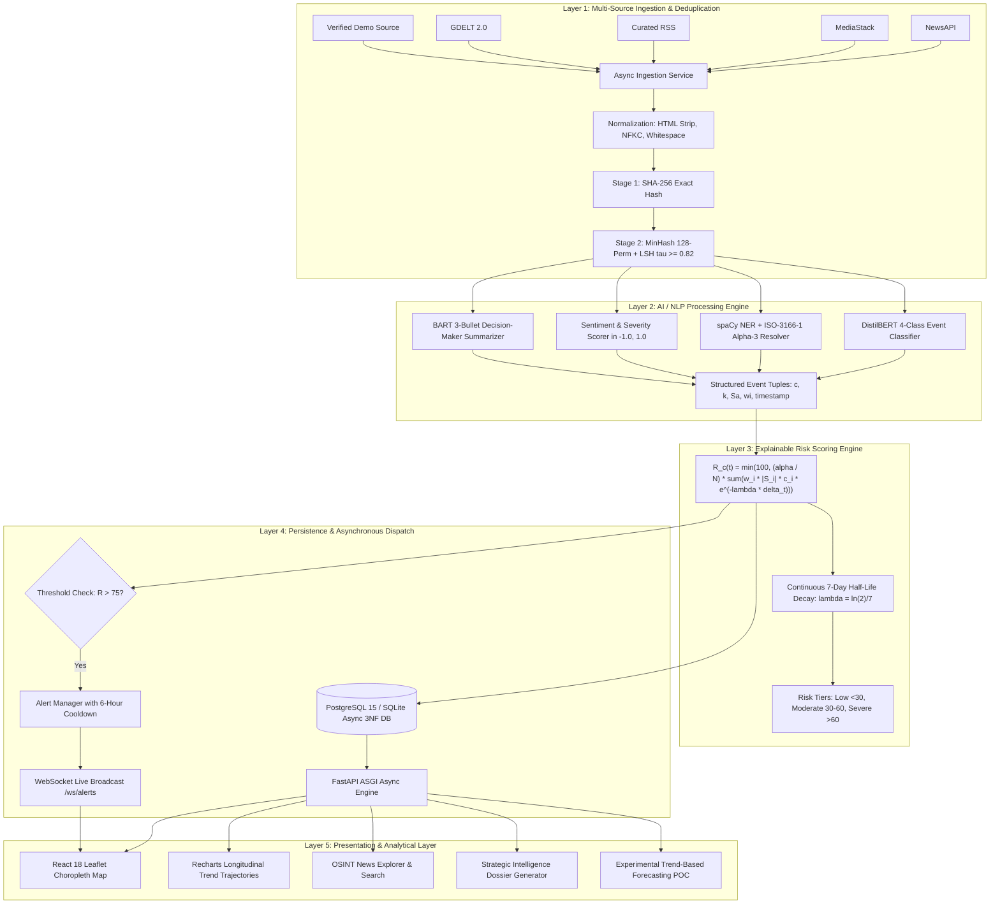

# GeoSentinel AI - System Architecture Document

## Overview
**GeoSentinel AI** is an AI-powered global geopolitical risk intelligence and trend-forecasting decision-support platform designed and implemented for the final year B.Tech capstone at Ajay Kumar Garg Engineering College, Ghaziabad (Department of Information Technology, CSIT Group 32).

The platform transforms high-velocity, unstructured Open-Source Intelligence (OSINT) into structured geopolitical event tuples, explainable country risk scores ($0 - 100$), real-time alerts, interactive geospatial visualizations, and exportable intelligence dossiers.

---

## 5-Tier Modular Architecture

---

## Key Distinguishing Contributions

1. **Explainable Scoring**: Transparent mathematical country-risk formula with exponential decay instead of black-box commercial heuristics.
2. **Two-Stage Deduplication**: SHA-256 exact matching combined with 128-permutation MinHash LSH ($\tau \ge 0.82$) achieving $< 1\%$ duplicate leakage.
3. **Automated Executive Briefings**: In-pipeline abstractive summarization delivering structured 3-bullet decision-maker briefings.
4. **Full-Stack Open Architecture**: FastAPI + PostgreSQL/SQLite + React 18 + Leaflet with real-time WebSocket situational awareness.
