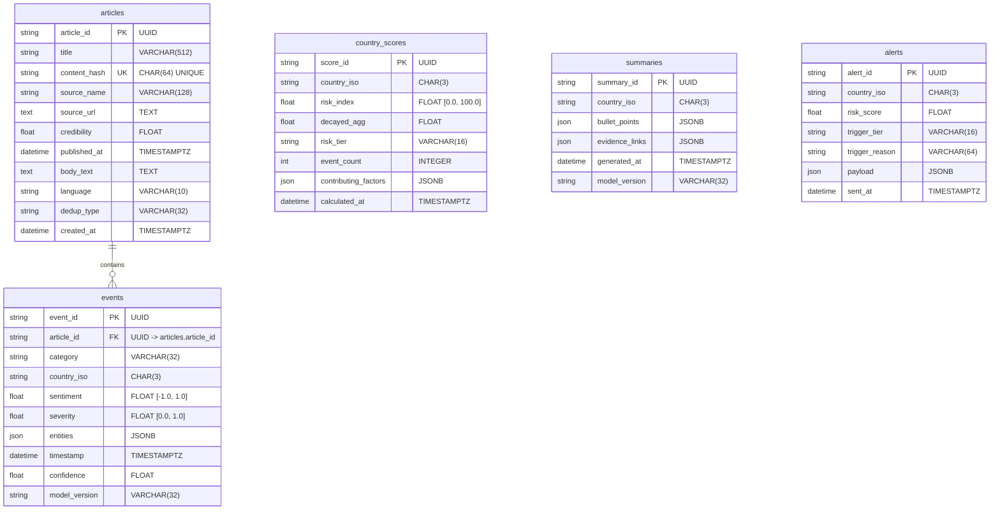

# GeoSentinel AI - Database Architecture (3NF)

## Relational Schema (Third Normal Form)

The GeoSentinel AI persistence layer implements the 3NF relational database architecture specified in Table 2 of the Academic Synopsis.

---

## Indexing & Performance Strategy
1. `articles.content_hash`: Unique B-Tree index for $O(1)$ Stage 1 exact deduplication.
2. `articles.published_at`: Descending index for rapid pagination of latest news feeds.
3. `events.country_iso`: Composite index with `timestamp` for instantaneous 30-day temporal window queries during country risk recalculation.
4. `country_scores.country_iso`: Indexed for immediate map choropleth retrieval.
5. `alerts.sent_at`: Descending index for real-time alert history drawers.
