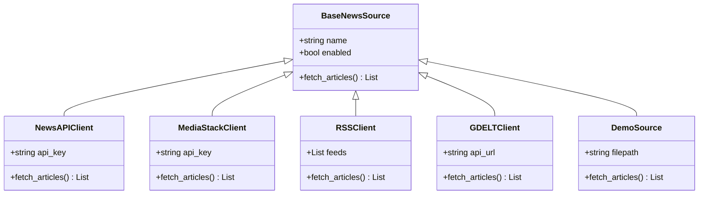

# GeoSentinel AI - Ingestion & Normalization Engine

## Overview
The ingestion subsystem polls multiple heterogeneous news APIs, wire services, and RSS feeds asynchronously, providing uniform schema normalization and resilient fault tolerance.

---

## Supported Source Adapters

---

## Fault Tolerance & Polling
- **Configurable Polling Interval**: Default 15 minutes.
- **Graceful Degradation**: If an external service is unavailable or exhausts API quotas, the pipeline continues processing from remaining active sources.
- **Academic Demo Mode (`DEMO_MODE=true`)**: Provides verified, clearly labeled baseline OSINT articles for consistent live conference presentations and evaluations without requiring live paid API keys.
