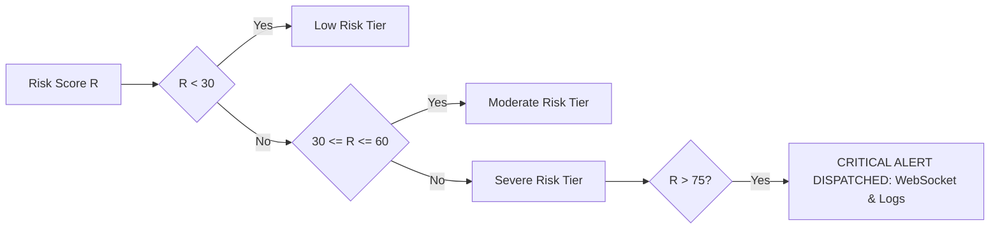

# GeoSentinel AI - Explainable Country Risk Engine

## Mathematical Formulation

The country risk index $R_c(t)$ is computed via the closed-form mathematical equation documented in Equation (1) of the Academic Synopsis:

$$R_c(t) = \min\left(100,\; \frac{\alpha}{N_c(T)} \sum_{i=1}^{N_c(T)} w_i \cdot |S_{a,i}| \cdot c_{s,i} \cdot e^{-\lambda(t - t_i)}\right)$$

---

## Variable Definitions

| Variable | Description | Value / Range |
| :--- | :--- | :--- |
| **$T$** | Observation sliding window | $30\text{ days}$ |
| **$N_c(T)$** | Active events for country $c$ within window $T$ | $N \ge 0$ |
| **$\alpha$** | Empirical normalization scalar | $4.25$ |
| **$\lambda$** | Continuous temporal exponential decay rate | $\frac{\ln 2}{7} \approx 0.099021\text{ day}^{-1}$ |
| **$w_i$** | Domain severity weight | $\text{Conflict: } 1.00$, $\text{Security: } 0.80$, $\text{Economy: } 0.55$, $\text{Diplomacy: } 0.35$ |
| **$|S_{a,i}|$** | Absolute sentiment polarity magnitude | $[0.0, 1.0]$ |
| **$c_{s,i}$** | Primary source credibility rating | $[0.1, 1.0]$ |
| **$t - t_i$** | Elapsed time since event publication | In fractional days |

---

## Continuous 7-Day Half-Life Decay

The temporal decay rate is analytically formulated such that an event's residual contribution is reduced by exactly 50% after seven days ($t - t_i = 7\text{ days}$):

$$e^{-\lambda \cdot 7} = e^{-\left(\frac{\ln 2}{7}\right) \cdot 7} = e^{-\ln 2} = \frac{1}{2} = 0.50$$

This guarantees that stale historical incidents gradually lose their weighting unless reinforced by fresh escalation signals.

---

## Risk Tiers & Alert Thresholds

- **Low Tier**: $R < 30$ (Green)
- **Moderate Tier**: $30 \le R \le 60$ (Amber)
- **Severe Tier**: $R > 60$ (Red)
- **Critical Alert Trigger**: $R > 75$ (Automated WebSocket broadcast with 6-hour country cooldown)
